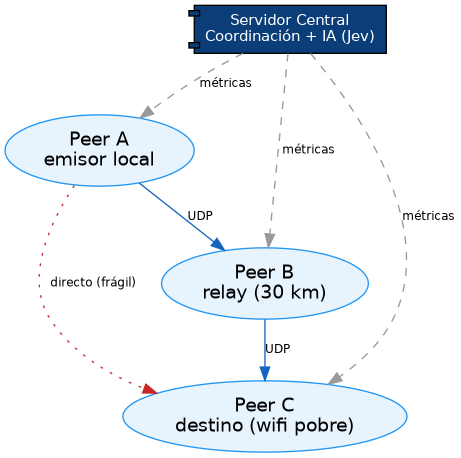
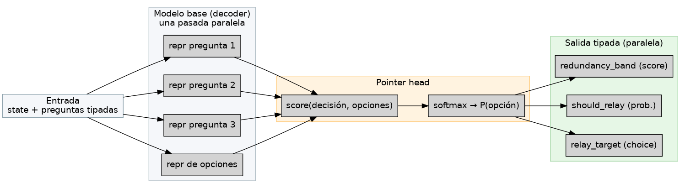
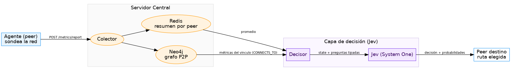
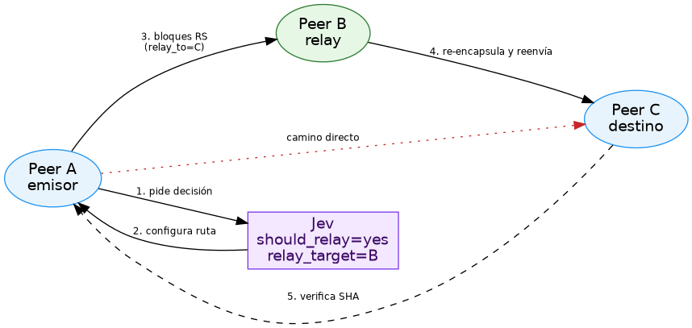

# RockDove + Jev: IA para la toma de decisiones en redes con pérdida

*Sistemas Inteligentes — diseño, arquitectura y mecanismo interno de la capa de decisión*

---

## 1. El tema central

Este trabajo integra **inteligencia artificial para la toma de decisiones** dentro de un sistema real de transferencia de archivos. El problema de fondo es simple de enunciar y difícil de resolver con reglas fijas:

> *Dado el estado de un vínculo de red (latencia, jitter, pérdida de paquetes, topología), ¿con cuánta redundancia enviar los datos y por qué camino?*

Tradicionalmente esa respuesta se decide con **tablas estáticas de umbrales**: valores duros que no se adaptan a la red. La propuesta es que decida un **modelo de decisión** —*Jev*— que evalúa el estado de la red y responde con una decisión *tipada*, acompañada de una **probabilidad calibrada** y una **confianza**. El código del sistema sigue siendo dueño de la ejecución, pero ahora trabaja con una señal de inteligencia más rica, con **incertidumbre explícita** y sin riesgo de alucinación.

> **RockDove** es el sistema: una plataforma P2P que transfiere archivos por UDP con corrección de errores **Reed-Solomon**. **Jev** es el modelo de IA que, dadas las métricas de red y la topología, decide cuánta redundancia usar y si conviene *saltar* por un host intermedio (relay) para llegar al destino.

### 1.1 ¿Por qué IA y no una tabla?

Una tabla de umbrales funciona cuando el mundo cabe en pocas reglas. El problema de la red es que el estado es **multidimensional y combinacional**:

- importan `rtt`, `jitter`, `pérdida` *y* su relación (un link puede tener RTT bajo pero pérdida alta, o viceversa);
- importa **el par** de peers, no un peer aislado (la redundancia la impone el peor de los dos extremos);
- importa la **topología** (¿existe un relay que mejore el camino?).

Un modelo de decisión puede tener en cuenta todas esas dimensiones a la vez y, además, **decir cuánta confianza tiene** en su respuesta. Ese es el argumento central: no es "más inteligente" por generar texto, sino porque **estructura la decisión** y **mide su propia incertidumbre**, dos cosas que el software necesita para operar de forma confiable.

---

## 2. RockDove: el sistema

RockDove es una plataforma de transferencia de archivos **peer-to-peer**. Aplica el algoritmo de corrección de errores **Reed-Solomon (RS)** sobre **UDP**: los datos sobreviven aunque la red pierda paquetes, sin retransmisión.

### 2.1 Cómo funciona

- **Plano de control** (servidor central): coordina presencia de los pares, recibe telemetría y produce decisiones. **Nunca toca los archivos.**
- **Plano de datos** (agente por máquina): cada par hace *encode/decode* RS, maneja el socket UDP y almacena localmente.

El emisor agrega **redundancia** antes de enviar: divide el archivo en bloques y genera paridad. Como la corrección es *forward* (FEC), el receptor reconstruye el original aunque lleguen menos paquetes, **sin contactar al emisor**.

| Preset | Redundancia | Pérdida tolerable |
|---|---|---|
| Rápido | 0.10 | 10 % |
| Balanceado | 0.25 | 25 % |
| Resiliente | 0.50 | 50 % |

Elegir redundancia baja en un enlace degradado produce fallas; alta en una red sana desperdicia ancho de banda. **De ahí la decisión inteligente.**

### 2.2 Topología de prueba real

El caso real tiene tres pares conectados por una red mesh (Tailscale):



- **Peer A** — el emisor local.
- **Peer B** — un relay, a ~30 km.
- **Peer C** — un destino en red wifi al límite de señal (pérdida alta).

Todos reportan métricas al servidor central, el único que **ve el estado completo** y donde vive la capa de IA. El camino directo A→C es frágil, de ahí la relevancia del *salto por B*.

---

## 3. Qué es Jev

**Jev** es el primer modelo *System One* de TypeSafe AI: una clase de modelos para tomar **decisiones estructuradas y rápidas** que el software consume directamente. Recibe (1) un **state** (contexto) y (2) una lista de **preguntas tipadas**, y devuelve por cada una una **respuesta tipada con probabilidad calibrada** y **confianza**.

> *Think of Jev as a function call: **estado en, decisión tipada y probabilística fuera.***

El nombre *System One* viene de Kahneman (*Pensar rápido, pensar despacio*): decisiones **rápidas e intuitivas** que el software consume, frente al razonamiento lento (System 2) de un LLM.

### 3.1 Las tres primitivas de decisión

| Primitiva | Pregunta | Devuelve |
|---|---|---|
| **`Choice`** | ¿Cuál opción? | La elegida + probabilidad por opción |
| **`Noul`** | ¿Se cumple la condición? | Probabilidad de "sí" (0–1) |
| **`Score`** | ¿En qué punto de una escala? | Posición ponderada + probabilidad por nivel |

Estas tres primitivas cubren lo que un sistema operativo necesita: *clasificar, decidir umbrales y medir grados.* No hay texto libre que parsear.

### 3.2 Por qué no es (sólo) un LLM

Un LLM genera símbolos; Jev **no genera, decide**. Esto tiene implicaciones operativas decisivas:

- **No alucina opciones:** como sólo puntúa las opciones que el desarrollador definió, es matemáticamente imposible que elija una que no exista. Un LLM, en cambio, puede inventar una llamada de herramienta o una categoría.
- **No produce errores de tipo:** la salida respeta el esquema pedido desde el inicio.
- **Sale con probabilidad:** cada decisión trae su nivel de confianza calibrado.

---

## 4. Cómo decide Jev *internamente*

Esta es la parte central del trabajo. La arquitectura interna de Jev no está publicada en detalle, pero su mecanismo se reconstruye a partir de su documentación y de modelos de referencia. El principio rector:

> **La IA no genera texto: compara representaciones de las opciones y obtiene una distribución de probabilidad.**

### 4.1 De "generar" a "comparar"

Un LLM clásico responde *generando* símbolos token a token (autoregresivo). Esto es lento, costoso y produce texto que hay que parsear, validar y del cual desconfiar. Un modelo de decisión encara lo mismo de otra forma: **codifica el estado y las opciones y puntúa cuál opción responde mejor a cada pregunta.** El resultado es una distribución de probabilidad directamente sobre las opciones del desarrollador.

### 4.2 Arquitectura interna

El flujo se modela en tres piezas encadenadas:

1. **Modelo base (decoder):** procesa `state` + preguntas y produce **representaciones vectoriales** (hidden states) para cada pregunta y para cada opción.
2. **Pointer head (cabeza de apuntado):** calcula una **puntuación de similitud** entre la representación de una pregunta y la de cada opción candidata.
3. **Softmax:** convierte las puntuaciones en **probabilidades** que suman 1.

```
Entrada (state + preguntas)
        │
        ▼
Modelo base (decoder) ──► representaciones de cada pregunta y opción
        │
        ▼
Pointer head: score(pregunta, opción)
        │
        ▼
Softmax ──► P(opción_1), P(opción_2), …
```

{width=90%}

Ejemplo ilustrativo (valores de puntuación):

```
scores:  returns 1.72 · shipping 1.21 · billing 1.08
softmax ──► P(returns)=0.47 · P(shipping)=0.28 · P(billing)=0.25
```

La aplicación ya no recibe texto a interpretar: recibe el `choice` y la **distribución**. Esa es la señal a comparar contra un umbral.

### 4.3 El paralelismo: una sola pasada

El otro rasgo interno decisivo es el **muestreo paralelo**: Jev emite todas las respuestas en **un solo pase**. Es el origen de su velocidad (70–500 ms frente a segundos o minutos de un LLM).

- Las preguntas se mantienen **aisladas entre sí**, de modo que ninguna "lee" la respuesta de otra.
- El `state` se procesa **una vez y se reutiliza** para todas las preguntas.

Consecuencia en RockDove: con las **mismas métricas de red**, el servidor pide en una sola llamada "¿qué redundancia?", "¿salto por relay?" y "¿por cuál relay?" — decisiones independientes que comparten contexto.

### 4.4 El entrenamiento: RLCD (calibración)

Jev se entrena con **RLCD — Reinforcement Learning for Calibrated Decisions**:

> En lugar de recompensar el texto que agrada (RLHF) o el que pasa una verificación (RLVR), RLCD recompensa que la **probabilidad sea honesta**: una decisión emitida con 0.8 debería acertar ~80 % de las veces, en promedio.

Esto le da a RockDove dos propiedades clave:

- **Calibración:** mayor confianza ⇔ mayor exactitud.
- **Incertidumbre explícita:** el sistema sabe cuándo Jev está seguro y cuándo delegar.

### 4.5 Jev vs. LLM en una tabla

| Aspecto | LLM clásico | Jev (System One) |
|---|---|---|
| Optimización | RLHF / RLVR | **RLCD** (calibración) |
| Salida | Texto (token a token) | Valor tipado + probabilidad |
| Muestreo | Secuencial | **Paralelo** |
| Riesgo | Alucinación / error de tipo | No elige opciones inexistentes |
| Tiempo | segundos–minutos | 70–500 ms |
| Consumo en la app | parsear y validar | listo para `if umbral` |

> **Nota de referencia.** El modelo abierto *Kev* — un "Jev-like" de pesos públicos — implementa exactamente este patrón (adaptador LoRA + cabeza puntero sobre un decoder Qwen). Sirve como referencia pedagógica del mecanismo de 4.2, sin ser Jev en sí.

---

## 5. Qué información usa Jev y cómo se almacena

Jev no adivina: **decide sobre datos.** El almacenamiento de telemetría es parte de la arquitectura. Hay dos capas de persistencia en el servidor:

- **Redis** — un resumen *por peer* de las últimas muestras (latencia media, jitter, pérdida). Vista "de un peer".
- **Neo4j** — un **grafo de conectividad**: cada par es un nodo `Peer` y cada vínculo medido es una *arista* `CONNECTS_TO` con `rtt_ms`, `jitter_ms`, `loss_rate`.

{width=90%}

### 5.1 El grafo como "mapa" del vínculo

La base de grafos **representa fielmente qué está conectado con qué.** Cada vez que un peer reporta métricas hacia otro, el servidor escribe la arista dirigida `Peer A → Peer B` con los últimos valores. Con `MERGE`, las aristas se crean o actualizan sin duplicarse: el mapa queda siempre en vivo.

Verificación real en el entorno (valores de los vínculos medidos):

| Origen | Destino | RTT | Jitter |
|---|---|---|---|
| peer-local | peer-server | 48 ms | 12 ms |
| peer-server | peer-local | 50 ms | 14 ms |
| peer-local | peer-isle | 116 ms | 48 ms |
| peer-server | peer-isle | 144 ms | 62 ms |

Estos son datos **medidos**, no simulados.

### 5.2 Por qué una base de grafos (y no sólo relacional)

Una tabla relacional guardaría métricas fila por fila. Pero la pregunta que hace la IA es de otra naturaleza: *"¿existe un camino B→C en buenas condiciones aunque A→C sea malo?"*. Eso es una **consulta de grafo** (nodos y aristas, caminos y vecindades). Un grafo responde a esto de forma natural: recorrer vecinos, encontrar rutas, evaluar aristas. Es exactamente el conocimiento que habilita la decisión de *saltar por un relay*.

### 5.3 Cómo Jev lo "ve"

El *decisor* (la capa que prepara la llamada a Jev) hace dos lecturas y las fusiona:

1. Consulta el **promedio** de cada peer en Redis.
2. Consulta el **vínculo directo** entre origen y destino en Neo4j (la arista `CONNECTS_TO`).

Con ambos construye un `state` consolidado: la métrica del tramo (con el peor valor entre ambos extremos, para proteger la transferencia) y la topología de relays disponibles. Ese `state` es lo que se envía a Jev junto con las preguntas tipadas. Así, la decisión de la IA se basa en el **estado real y medido** de la red.

---

## 6. El desglose de decisiones (con quién habla RockDove)

Jev no decide "todo en una pregunta gigante". El diseño sigue el patrón de **descomponer el problema en decisiones independientes y tipadas**, y combinar los resultados en código.

### 6.1 Las preguntas que hace RockDove

```
state (consolidado):
  { "link": { rtt_ms, jitter_ms, loss_rate, network_profile },
    "topology": { source_peer, target_peer, relay_candidates: [...] } }

questions:
  redundancy_band  (Score)  → niveles ordenados de redundancia (5%…50%)
  should_relay     (Noul)   → ¿saltar por un relay?
  relay_target     (Choice) → direct | <cada relay candidato>
```

### 6.2 Por qué paralelas y no encadenadas

Las tres preguntas son **independientes** sobre el mismo estado: redundancia, relay-sí-o-no, y relay-cuál. Como Jev las evalúa en paralelo, RockDove las pide juntas en una sola llamada. Si fueran dependientes (si la respuesta de una condicionara la siguiente), sí haría falta encadenar; pero acá comparten el mismo contexto, así que se ganan en una pasada.

### 6.3 De la probabilidad a la acción: el *confidence gate*

La salida de Jev se combina con el código de forma segura:

- **Confianza alta** (> umbral) → se aplica la decisión de la IA.
- **Confianza baja** → se cae a la tabla determinista existente (comportamiento conocido y seguro).

Esto hace a la IA **aditiva**: nunca degrada el sistema actual, sólo lo mejora cuando está segura. Es la combinación de *System One* (la IA decide rápido) con un *guardrail* determinista. Es la práctica estándar para estos modelos: *"actúa cuando esté seguro, escala cuando no lo esté"*.

---

## 7. El salto por relay (A → B → C)

Uno de los casos que resuelve Jev es si conviene **recorrer un camino indirecto** (A → B → C) en lugar del directo (A → C).

{width=70%}

### 7.1 El flujo completo

1. El emisor A pide a Jev la decisión de tránsito para llegar a C.
2. Jev evalúa el estado y responde `should_relay = true`, `relay_target = B`.
3. A configura la transferencia **proactivamente** por B (no espera a que falle el directo).
4. B recibe bloques RS de A con destino C, los **re-encapsula** y reenvía.
5. C verifica la integridad y confirma a A.

### 7.2 Proactivo vs. fallback

La diferencia clave con un diseño ingenuo: **el salto es proactivo, no reactivo.** Muchos sistemas sólo usan relay cuando el camino directo falla (fallback). Acá, Jev decide *antes* de intentar el directo, basándose en el estado del grafo: si el directo A→C es malo y existe B→C bueno, salta por B sin desperdiciar el intento. Es posible porque el grafo (Sección 5) conoce la conectividad real.

### 7.3 El relay y el re-encode

El relay B **no guarda** el archivo: es un nodo de tránsito. Recibe los bloques, los re-encapsula en el socket hacia C y los reenvía. El relay puede, además, **recalcular la redundancia** para el tramo B→C si ese enlace tiene peor calidad que A→B, aplicando la misma decisión inteligente por tramo.

---

## 8. Verificación empírica: ¿Jev decide o es azar?

Una duda razonable frente a una IA es si sus respuestas **correlacionan con el problema** o son ruido. Se diseñó una prueba: mismas topología, métricas distintas, y repetir la llamada varias veces por escenario.

### 8.1 Correlación con el estado del vínculo

| Escenario | Estado del tramo | Banda Jev | r aplicado | ¿Relay? |
|---|---|---|---|---|
| `lan` | 12 ms, pérdida 0 % | 0.1 | 0.05 | No |
| `wifi` | 45–60 ms, pérdida 5 % | 1.4 | 0.10 | No |
| `satellite` | 420–480 ms, pérdida 32 % | 3.4 | 0.40 | **Sí** |

A medida que el vínculo empeora, la banda que elige Jev **sube ordenadamente** y la redundancia aplicada tambiín. **Correlación clara** con las métricas: señal de que decide, no que tira al azar.

### 8.2 Estabilidad entre llamadas repetidas

Por escenario, se repitió la consulta tres veces y las bandas devueltas fueron casi idénticas:

- `lan`: 0.10 / 0.12 / 0.13
- `wifi`: 1.40 / 1.45 / 1.47
- `satellite`: 3.38 / 3.39 / 3.40

La estabilidad descarta el azar: un modelo que respondiera al azar no daría valores tan consistentes para el mismo estado.

### 8.3 Verificación end-to-end del salto real

En el entorno real de tres máquinas, al degradar el vínculo hacia C, Jev respondió `should_relay = true`, eligió a B y **el sistema ejecutó un salto A→B→C real**:

- A envió 32 bloques RS a B (relay a ~30 km);
- B reenvió a C;
- C decodificó y verificó la **SHA-256**, que coincidió con el checksum original.

El archivo llegó **íntegro** al destino pasando por el relay que la IA seleccionó.

### 8.4 Sobre la confianza y los umbrales

La prueba también mostró el *confidence gate* en acción: en el escenario `lan` la confianza fue alta (≈0.90) y se usó Jev directo; en `wifi`/`satellite` la confianza bajó (≈0.60–0.65). En un diseño de producción el umbral se calibra según el costo de cada error, no por un número redondo: si errar sale caro, se sube el umbral y se delega más a la regla determinista.

---

## 9. Decisiones de diseño en la implementación

El objetivo no fue sólo "llamar a una API de IA", sino **integrarla de forma robusta**. Las decisiones de diseño clave fueron:

### 9.1 Credenciales y API

- Se consume Jev **vía OpenRouter** (endpoint de decisiones, modelo `typesafe/jev-1.13`) con una API key del lado del **servidor** — nunca en el cliente.
- El cliente nunca habla con el proveedor de IA: le pide al servidor RockDove la decisión, y el servidor orquesta la llamada a Jev. Esto centraliza credenciales y lógica.

### 9.2 Fallo degradado (fail-safe)

Si Jev está deshabilitado, sin clave, o falla (red, timeout), el sistema **no se rompe**: cae a la tabla determinista. La IA es un *mejorador*, no una dependencia crítica del flujo.

### 9.3 El modelo de decisión como función

Se modeló a Jev como **función**: `state + preguntas → decisiones tipadas`. Esto permitió:

- testear el mecanismo con datos mock y reales;
- desacoplarlo del resto del sistema (si mañana cambia el proveedor, cambia una pieza);
- combinarlo con lógica determinista por umbral.

### 9.4 Las métricas como insumo

Se diseñó junto a la IA la **telemetría necesaria**: sin RTT, jitter y pérdida no hay decisión informada. El almacenamiento en grafo (Neo4j) complementa a Redis para representar conectividad, no sólo agregados.

---

## 10. Limitaciones y honestidad

Una mirada honesta a lo que esta integración tiene y lo que le falta:

- **Pérdida UDP real:** los sondeos HTTP miden RTT y jitter, pero la pérdida reportada suele ser 0. El dato más discriminatorio del "wifi al límite de señal" (pérdida de paquetes UDP real) aún no se captura con precisión; mejorarlo haría más informada a la IA.
- **Calibración del umbral:** el valor de "confianza suficiente para actuar" debe ajustarse con datos del uso real, no con un valor fijo.
- **Arquitectura interna de Jev:** no es pública en detalle; este documento la describe a partir de su documentación y de modelos de referencia. La descripción es fiel al *concepto* (System One, pointer head, softmax, RLCD) aunque el detalle de implementación exacto no se publicó.
- **Costo:** Jev se cobra por tokens de entrada; las probadas con miles de llamadas son baratas, pero en producción masiva conviene medir y, si hace falta, cachear o usar un modelo abierto equivalente localmente.

---

## 11. Conclusión

Jev aporta a RockDove una capa de **decisión probabilística y calibrada** que reemplaza la rigidez de una tabla de umbrales. Su mecanismo interno lo entiende como una *System One*: un modelo base que codifica estado y preguntas, una *pointer head* que puntúa opciones y un *softmax* que produce la distribución, todo en **muestreo paralelo**, entrenado con **RLCD** para que la confianza sea honesta.

La integración demuestra que un *Sistema Inteligente* no siempre necesita "conversar": a veces sólo necesita **decidir** con una señal estructurada y calibrada que el código pueda consumir con umbrales e incertidumbre explícita. Apoyado en un grafo que representa la red real, la IA no sólo recomienda cuánta redundancia usar, sino también **por qué camino llegar**: directo o saltando por un relay. Ese es el tipo de decisión operativa que esta clase de IA puede automatizar de forma confiable.